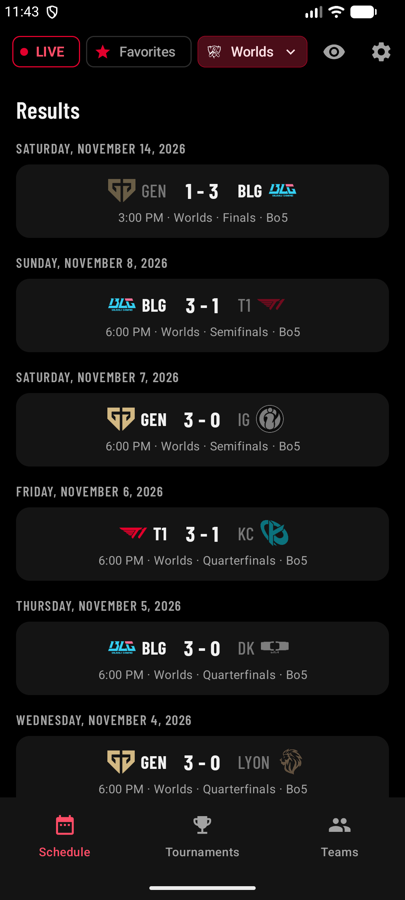
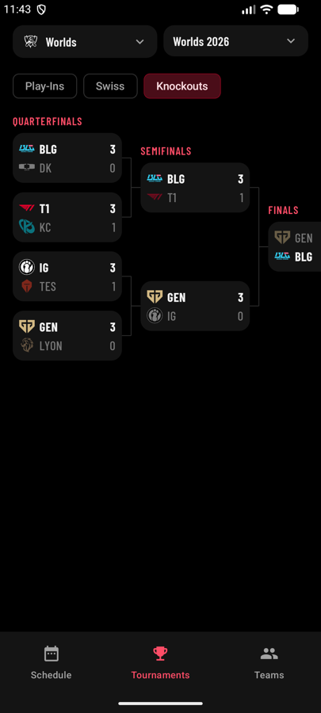
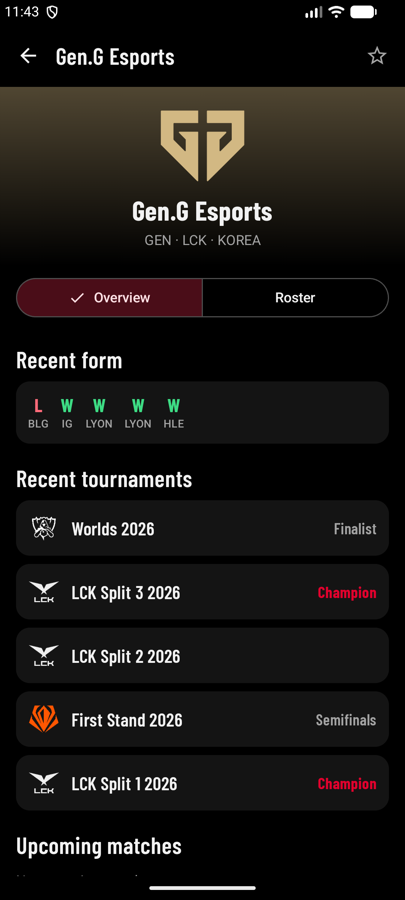
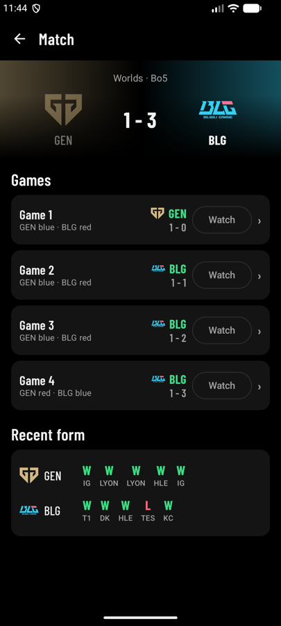

# LolSito

An Android app to follow League of Legends esports: the schedule, live matches, tournament standings and brackets, and team profiles.

  
  
  
  

## Features

- **Schedule**: live, upcoming and finished matches, filtered by league or by your favorite teams, plus upcoming tournaments.
- **Tournaments**: each stage on its own, with ranking tables, regular-stage matches with a team filter, Swiss stages and elimination brackets.
- **Teams**: search teams and players. A team profile shows its next match, recent form, recent tournaments with how far it got, its matches and its roster by role.
- **Matches**: the games of a series with links to the VODs, and per-game items, stats and gold difference.
- **Reminders**: a notification when a favorite team's match starts, or for any upcoming match you mark with "Remind me".
- **No spoilers**: hide finished scores until you reveal them.
- **Offline**: recent data is cached, so the app still shows it without a connection.

## Built with

Kotlin, Jetpack Compose with Material 3, Navigation Compose, coroutines and Flow, Retrofit with kotlinx.serialization, Coil, DataStore and WorkManager.

The code is organized by feature (`schedule`, `standings`, `teams`, `match`, `game`, `reminders`, `settings`), each split into `domain`, `data` and `ui` layers, with shared code under `core`. Screens use ViewModels with `StateFlow` and stateless composables, and the domain and ViewModels are covered by JVM unit tests.

## Running it

Open the project in Android Studio and run the `app` configuration. It needs Android 7.0 (API 24) or later. Unit tests run with `./gradlew testDebugUnitTest`.

## Data

Data comes from the unofficial LoL Esports web API, the one lolesports.com uses, and from Data Dragon for champion and item art. Sample responses live in [docs/samples](docs/samples/README.md). This project is not affiliated with or endorsed by Riot Games.
